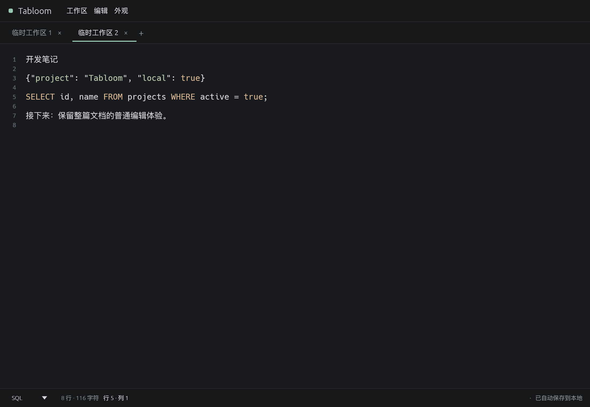

# Tabloom

Rust 原生多标签纯文本编辑器。每个标签是一份连续文档，可以选中整行设置独立语法；区域只作为后台文本与语法范围存在。

**核心候选版：多区域编辑、本地恢复与文件互操作已实现，macOS 与 Linux ARM64/X11 验收通过，Windows 尚待验证。** 无需命名或选择路径，正常关闭应用会保留全部工作区，不逐个要求另存为。文件修改同时保留内部恢复副本，只有主动保存时才写回原文件。



## 已实现

- 新建、切换、关闭工作区；关闭标签可在“工作区 → 最近关闭”中重新打开，重启后仍可找回。永久删除需要明确确认。
- 每个标签只有一个无边框文档编辑器、一套滚动条；没有区域标题栏、卡片边框或高度分隔线。
- 选中一整行或多行，右键直接选择 JSON、SQL 等格式；底部只读显示当前格式，其他文本不受影响。
- Markdown 范围默认渲染，双击编辑源码，焦点离开或按 Esc 恢复预览；始终保存原始 Markdown。
- 19 个真实语法选项（含纯文本）：JSON、YAML、TOML、Markdown、Rust、Go、Python、JavaScript、TypeScript、HTML、CSS、SQL、Shell、PowerShell、C、C++、Java、XML。
- 简体中文界面、系统中文/Emoji 字体回退、四套内置主题、字号调整、行数/字符数和自动保存状态栏。
- egui 多行编辑、文档级撤销重做、Tab/Shift+Tab 缩进、Home/End、方向键及 PageUp/PageDown；保留 Unicode 和混合换行。
- 当前文档内字面文本查找、匹配计数、当前匹配高亮、前后循环导航、大小写及 Unicode 全词匹配，替换当前/全部均可撤销。
- arboard 纯文本剪贴板；失败显示错误，剪切先成功复制再删除，避免剪贴板失败造成内容丢失。
- 系统文件选择器打开为新标签；UTF-8/BOM、UTF-16 LE/BE（带 BOM），关联文件保留原编码写回，临时区域显式导出 UTF-8。SHA-256 指纹检查外部修改，失败不覆盖。
- JSON 文件原子提交自动保存、恢复活动标签/语法范围及文本顺序、主题/字号和窗口大小；完整备份、损坏检查、单实例写入保护和可见的保存失败反馈。

日志暂用纯文本，没有伪装成已实现的“日志语法”。macOS 已验证真实系统剪贴板仅含纯文本，中文、Emoji、Tab 和 CRLF/LF/CR 原样保留；Linux ARM64/X11 也已通过真实 xclip 剪贴板验证；Windows 尚未验证原生系统剪贴板。

## 构建与运行

需要 Rust **1.95 或更新版本**、平台 C/C++ 编译工具链，以及可用的图形桌面/OpenGL 驱动。依赖通过 Cargo.lock 固定。

- macOS：安装 Xcode Command Line Tools；本项目在 macOS ARM64、Rust 1.99.1 实际构建并原生运行。
- Windows：使用 Rust MSVC 工具链和 Visual Studio C++ Build Tools；尚未在 Windows 实际构建。
- Linux：需要编译工具、pkg-config、Fontconfig 和 X11/Wayland/OpenGL 开发库，以及中文/Emoji 字体（例如 Noto CJK、Noto Color Emoji）。文件选择器采用 XDG Desktop Portal，还需要会话 D-Bus、xdg-desktop-portal 及对应桌面的 portal 后端（如 GTK/KDE），无需启用 rfd 的 GTK3 编译后端。已在 Linux ARM64 Debian bookworm 容器实际构建并通过 Xvfb/Mesa X11 运行验证；Windows 与 Linux x86_64 尚未实际编译。最小环境还需 `libxkbcommon-x11` 动态库，完整实测清单见 [验证镜像](scripts/linux-validation.Dockerfile)；参考 [eframe 原生构建说明](https://docs.rs/crate/eframe/0.37.0/source/README.md)。

### macOS 日常启动

安装标准原生应用包（默认 release）：

```sh
./scripts/macos-app.sh release --install
```

安装到 `~/Applications/Tabloom.app`，在 Finder 中打开用户目录的“应用程序”，双击 Tabloom，或用 Spotlight 查找 Tabloom。可以将它拖到 Dock。应用通过 macOS Launch Services 直接打开窗口，不需要终端。更新后先正常退出旧实例，再打开新版。

不要双击 `target/release/tabloom` 或 `Contents/MacOS/tabloom`；它们是包内的 Unix 可执行文件，Finder 会通过终端运行。日常使用的入口是 **Tabloom.app**。

默认运行 `./scripts/macos-app.sh` 也会构建 release 并更新这个唯一入口，旧的同名 debug/release 应用包会取消登记并归档到 `target/retired-apps/`，不影响工作区数据。应用包含原生多尺寸图标。

需要独立开发包时显式使用 `--local`，名称和标识均与日常使用的 Tabloom 区分：

```sh
./scripts/macos-app.sh debug --local
open "target/debug/Tabloom Dev.app"
```

这是本地应用包，尚未提供发布签名、公证、安装器或发布流水线。

### 开发与其他平台

常规 Rust 环境：

```sh
cargo run --locked
cargo build --release --locked
```

当前工作目录预装的工具链未加入全局 PATH，可使用仓库脚本自动选择工具链：

```sh
./scripts/cargo.sh run --locked
./scripts/cargo.sh build --release --locked
```

`cargo run` 是终端内的开发启动方式。也可以按 [环境记录](docs/05-environment.md) 在当前终端设置路径。脚本不会修改全局配置。

Windows/Linux 在各自原生环境运行 `cargo build --release --locked`，二进制分别为 `target/release/tabloom.exe`、`target/release/tabloom`。

## 使用

macOS 的工作区、编辑、外观和窗口菜单位于系统屏幕顶栏；应用窗口不再重复显示菜单栏。Tabloom 菜单提供关于、隐藏和退出，退出仍经过自动保存检查。Windows/Linux 保留窗口内菜单。

点击“新建工作区”后直接输入，整份文档默认纯文本。各标签使用独立文档、选区和撤销栈。

需要为一段文本设置语言时：

1. 从行首开始选中一整行或多行，可以不选中最后一行的换行符。
2. 在文档内点击右键，在“设置选中行格式”下直接选择 JSON、SQL、纯文本等格式，无需先创建区域。
3. 底部状态栏只读显示光标或选区对应的格式；跨越不同格式时显示“混合格式”。再次选中整行并右键选择格式即可修改，其他文本不受影响。

转换不会插入分隔符、改变换行或修改文本。选中部分行时转换项不可用；跨越不同关联文件来源的转换会提示分别操作。区域没有可见边框，支持跨区域拖选、全选、复制、剪切、查找和替换，共用文档滚动及文本撤销重做。重新选择整行并转换可以重新划定语法范围。

### Markdown 自动预览

选中整行，右键将格式设为 **Markdown**，即可自动预览。双击预览内容（或右键“编辑 Markdown 源码”）进入该范围的源码编辑；点击其他输入区域、切换标签、切换应用或按 Esc 后恢复预览。空白 Markdown 不显示占位预览；整篇空白时保留普通源码输入位置。多个 Markdown 范围独立切换，其他语言仍显示源码。

支持 CommonMark 标题、段落、强调、列表、引用、代码块，以及表格、删除线、任务列表等扩展显示。采用与 egui 0.37 匹配的 egui_commonmark 0.26.0，未启用网络图片、文件图片加载、SVG、HTML/脚本执行或数学公式扩展。超过 256 KiB 的 Markdown 显示源码，并提示暂停预览。

预览是显示层，保存、导出和恢复仍使用原始文本；预览右键“复制 Markdown 源码”复制原始 Markdown。源码内的复制、剪切和粘贴仍为纯文本，预览文本不直接参与编辑。

混合预览下，各个源码范围有独立光标和撤销记录。需要跨范围拖选、全选整篇、复制或重新划分格式时，点击底部 **“编辑整篇源码”**；点击 **“恢复 Markdown 预览”** 返回。查找替换自动在整篇原始源码中进行，关闭查找后回到预览。包含 Markdown 的预览排版不显示源码行号；整篇源码模式保留原有行号。

为避免切换预览/源码时下方内容跳动，本次打开期间会保留已用过的范围高度；切换标签后重新计算。预览/编辑模式属于临时 UI 状态，不持久化，重启后回到预览。

少用的新增、定位和删除操作收进“编辑 → 区域操作”；删除需要确认，最后一个区域删除后保留空白文档。高度拖动与独立区域滚动已取消，旧数据库的高度字段保留兼容，不再参与显示。旧工作区文本按原区域顺序直接拼接，不自动补换行；若原相邻区域没有换行，恢复后会显示在同一行。

关闭标签保留内容，通过“工作区 → 最近关闭”重开。仅明确执行“永久删除”才移除工作区；滚动备份中可能仍有旧副本。主题、字号及窗口大小会恢复，窗口位置尚未恢复。

“编辑”菜单操作针对最后聚焦的文本输入框；从查找框打开菜单不会误改文档。选区跨菜单和标签切换保留，撤销栈仅在当前进程内存在。整行转换和语言设置本身不作为可撤销的文本操作，删除区域也不通过文本撤销恢复。

查找面板针对当前整份文档，匹配可以跨语法范围。输入查询显示第一个匹配；用上一个/下一个或 F3/Shift+F3 导航并选中匹配。替换框中的 `$1`、反斜杠按原文处理，不作正则展开。Tab 插入制表符，选中多行时整体缩进；Shift+Tab 减少一个 Tab 或最多四个前导空格。剪贴板若只有图像而无文本，会显示读取错误。

## 选择工作区目录与查看保存位置

“工作区 → 选择工作区目录…”可以选择专用文件夹，选择会记住，下次启动自动打开：

- 选择空目录：把当前全部标签、文本、语法范围和外观保存过去，然后继续在新目录工作。
- 选择已有 Tabloom 工作区：先保存当前工作区，再打开所选目录；原工作区文件保留，不覆盖已有内容。
- 目标目录正被其他实例占用、不可写或无效：显示原因，当前文本与保存位置保持不变。

状态栏“保存位置”可查看完整路径，点击“打开保存目录”会打开访达/资源管理器/系统文件管理器。恢复模式直接显示实际目录，并提供“以后使用当前恢复目录”，让这个目录成为正常默认工作区；也可选择空目录带走当前内容。

目录用于应用的内部 JSON 和备份，不是普通文本文件的导出位置，建议选一个专用文件夹。选择记录保存在应用标准配置目录的 `workspace-location.json`；未选择时沿用原默认目录。切换已有目录会重置该窗口的光标/撤销等临时状态；保存到空目录时保留当前编辑状态。不同工作区目录不会自动合并。

详见 [目录选择实施记录](docs/17-directory-report.md)。

## 四套外观

在“外观”菜单直接切换，选择会自动保存：

| 主题 | 风格 |
| --- | --- |
| A · 石墨极简 | 灰黑底色、薄荷绿细下划线标签 |
| B · 纸白原生 | 白色文档、融入文档的浅色标签 |
| C · 深海工作台 | 蓝灰底色、蓝紫顶部强调线 |
| D · 暖砂留白 | 暖灰纸色、柔和活动标签、无行号 |

A/B/C 显示轻量行号，D 保持纯文档感；行号只参与绘制，不进入文本和剪贴板。关闭按钮为无背景小叉，新建按钮为标签栏加号。空白文档仅显示“开始输入…”的轻提示。窗口内控件、弹窗、状态栏、光标、选区和语法色都跟随主题；macOS 系统菜单遵循系统外观。

首次启动默认 A；旧版深色/浅色偏好分别对应 A/B。选择后的主题跨重启恢复，不需要再次迁移工作区。主题只调整显示，保留文本、选区和撤销记录。运行效果见 [四主题实施记录](docs/15-themes-report.md)。

## 打开、保存和导出真实文件

“工作区 → 打开文本文件”（Ctrl/Cmd+O）使用系统选择器；选中的文本文件会进入独立标签的第一个区域，用文件名作显示标题。仅根据扩展名建议初始语言，可以随时手动覆盖。取消选择器不创建标签、不写入文件。

支持严格 UTF-8、UTF-8 BOM，以及带 BOM 的 UTF-16 LE/BE。保留中文、Emoji、空格、Tab 和原有换行；BOM 属于文件编码元数据，不显示或复制到文本。保存关联文件时保留检测到的编码及 BOM。其他编码、无效字节、UTF-32、包含 NUL 的疑似二进制文件会报错，不作有损转换。暂不猜测无 BOM 的 UTF-16。

Ctrl/Cmd+S 始终针对当前活动编辑区域，即使光标在查找框：

- 有文件关联：先提交内部恢复副本，再将本标签中关联同一文件的所有文本片段按顺序拼接写回。整行转换不会导致只保存片段、截断原文件；成功后更新所有相关片段的文件指纹并持久化。
- 临时区域：提交内部工作区，提示已自动保存；不要求文件名，不弹另存为。

“导出当前区域（UTF-8）”才会弹出保存选择器，导出不带 BOM 的 UTF-8 副本，保留原文换行，不把临时区域变为关联文件。选择已有文件时由系统对话框确认覆盖；如果选择的恰好是该区域原关联路径，则采用关联保存规则，保留编码并检查冲突。

关联路径和编码、最后保存的文件指纹随工作区恢复。若磁盘文件被外部修改或删除，Ctrl/Cmd+S 会拒绝覆盖；本地修改仍在内部工作区文件，可导出另一路径，或重新打开磁盘版本进行比较。当前不提供强制覆盖或自动合并。

写入先在同目录创建临时文件、刷新内容，再替换目标文件，避免普通写入失败截断原文件；保留普通文件权限位。保存冲突用 SHA-256 在写入前和替换前复核，但不能消除其他进程同时写入的最后竞态。原子替换不保证保留 ACL、扩展属性、硬链接关系或断电瞬间的目录项持久性。通过符号链接打开会解析并关联真实目标，保存保留原符号链接。

应用数据目录及其备份/恢复目录受到保护，不能作为普通文本打开或导出覆盖。内部工作区文件不是文本文件。

## 自动保存、数据目录和恢复

文本和结构变化后约 **400ms** 合并写入，连续输入最长约 **2 秒**触发保存，失败约 **3 秒**重试。每个变化的工作区先写入独立 UTF-8 JSON 版本，最后原子替换 `session.json` 提交清单；只有提交成功才显示已保存。未变化的工作区文件复用。正常退出再次保存和备份，无需逐个命名或另存为。自动保存不覆盖关联的真实文件。

强杀可能丢失最后尚未提交的输入；已经提交的文件在重启后恢复。撤销栈和光标选区不跨重启保存。当前文件格式版本为 **1**，不再链接或使用 SQLite。

数据通过 `directories::ProjectDirs` 定位：

| 系统 | 默认目录 |
| --- | --- |
| macOS | `~/Library/Application Support/org.tabloom.Tabloom/` |
| Windows | `%LOCALAPPDATA%\tabloom\Tabloom\data\` |
| Linux | `$XDG_DATA_HOME/tabloom/`，未设置时为 `~/.local/share/tabloom/` |

目录内容：

- `session.json`：格式版本、标签顺序、活动标签、编号及外观偏好和工作区引用。
- `workspaces/<UUID>-<SHA256>.json`：各工作区文本、语法范围、文件关联及恢复元数据。内容寻址文件由应用维护，手工修改会导致校验失败。
- `instance.lock`：跨平台单实例锁；不要删除正在使用的锁文件来绕过保护。
- `backups/backup-*.json`：独立的完整快照，保留最近 3 份；最多每 60 秒备份一次，启动和正常退出也会尝试备份。
- `recovery/archive-*/`：恢复前保留的原清单、工作区文件、诊断原因与恢复来源，不自动删除。

每次提交后会清理清单不再引用的旧工作区版本；完整备份仍可能保留已删除内容。发布工作区文件与清单使用同目录临时文件、同步及原子替换；Unix 另同步父目录，Windows 没有 std 目录同步实现，不承诺任意硬件断电情形绝对可靠。

启动校验格式、SHA-256、引用和模型关系。损坏或引用缺失时先归档原件，再恢复最新有效完整备份，并提示备份时点。原工作区不可读取时，自动打开独立的恢复工作区继续编辑，不覆盖原数据；恢复目录也不可写时仍可编辑，并明确提示仅在内存。备份并非每次按键生成，恢复可能回退到较早时点。

## 启动不会阻塞编辑

程序只识别自己的 JSON 工作区文件，忽略目录中的其他文件；没有旧格式识别或迁移流程。

主工作区被占用、损坏或目录不可写时，应用仍会打开可编辑窗口，优先保存到独立恢复目录：主数据目录旁的 `<目录名>.recovery/`，其次是用户缓存目录下的 `Tabloom/recovery-workspaces/` 或系统临时目录下的 `tabloom-recovery/`。详情面板显示实际位置，状态栏明确显示“已保存到恢复工作区”。优先使用稳定目录，以便下次主工作区仍不可用时恢复本次内容；同一恢复目录也被占用时会另开隔离目录。

恢复目录不会覆盖或自动合并进主工作区。系统临时目录可能被操作系统清理，重要内容应主动导出。若所有位置都不可写，仍然允许编辑，明确显示“仅在内存”，并提供导出和复制恢复数据；不会伪报已保存。异常提示只占据上方通知区，不替换整个编辑界面。

## 保存失败排查

保存失败顶部持续提示，内存内容保留，编辑可以继续。检查磁盘空间、数据目录权限、目录是否被同名文件占用，以及是否有其他 Tabloom 实例；可点击“重试保存”。不要删除清单或工作区文件来处理普通写入错误。

关联文件写回前若内部恢复副本保存失败，本次写回会阻止；仍可导出到其他路径应急，提示继续保留未保存状态。若真实文件已写入而关联状态提交失败，提示会明确区分。文件冲突不清除内部文本。

可使用“复制全部恢复数据（JSON）”将内存中全部工作区复制为恢复副本。退出保存失败会保留窗口，允许重试、复制或明确放弃未提交更改。备份或旧版本清理失败单独提示，已提交的内容不会误标为未保存；第二实例使用独立恢复工作区，避免覆盖另一个实例的数据。

## 本阶段快捷键

| 操作 | macOS | Windows / Linux |
| --- | --- | --- |
| 打开文本文件 | Cmd+O | Ctrl+O |
| 保存当前关联文件 / 提交临时工作区 | Cmd+S | Ctrl+S |
| 新建工作区 | Cmd+N | Ctrl+N |
| 关闭当前工作区 | Cmd+W | Ctrl+W |
| 下一个工作区 | Ctrl+Tab | Ctrl+Tab |
| 上一个工作区 | Ctrl+Shift+Tab | Ctrl+Shift+Tab |
| 撤销 | Cmd+Z | Ctrl+Z |
| 重做（egui 提供） | Cmd+Shift+Z | Ctrl+Y / Ctrl+Shift+Z |
| 全选 / 复制 / 剪切 / 粘贴 | Cmd+A/C/X/V | Ctrl+A/C/X/V |
| 查找 | Cmd+F | Ctrl+F |
| 查找与替换 | Cmd+Shift+H | Ctrl+H |
| 下一个 / 上一个匹配 | F3 / Shift+F3 | F3 / Shift+F3 |
| 在查找框内导航匹配 | Enter / Shift+Enter | Enter / Shift+Enter |
| 关闭查找并聚焦区域 | Esc | Esc |
| 增大 / 减小字号 | Cmd+加号或等号 / Cmd+减号 | Ctrl+加号或等号 / Ctrl+减号 |
| 制表符 / 多行缩进 / 减少缩进 | Tab / Tab / Shift+Tab | Tab / Tab / Shift+Tab |
| 翻页及扩展选区 | PageUp/PageDown，配合 Shift | PageUp/PageDown，配合 Shift |

macOS 的 Cmd+Tab 由系统用于切换应用，应用内采用 Ctrl+Tab；Cmd+H 用于隐藏应用，因此替换采用 Cmd+Shift+H。Windows/Linux 另支持 Ctrl+Insert 复制、Shift+Insert 粘贴和 Shift+Delete 剪切。字号范围为 10–32。导出通过菜单主动触发；界面没有未实现的占位按钮。

## 测试与验证

```sh
cargo fmt --all -- --check
cargo check --locked
cargo test --locked
cargo clippy --all-targets --all-features --locked -- -D warnings
```

本地工具链环境可以把以上 `cargo` 替换成 `./scripts/cargo.sh`。

有图形桌面时可以运行独立的原生冒烟程序：

```sh
./scripts/cargo.sh run --example native_smoke -- target/native-smoke.png
```

该程序在真实原生渲染器中向 egui 注入文本/快捷键事件，验证多区域、多标签、语言隔离和撤销重做，保存截图后自动退出；失败时断言报错。它不会访问现有工作区数据，也不等同于系统实体键盘、输入法或剪贴板测试。

有桌面和 Python 3 时，还可以运行隔离的跨进程持久化验证：

```sh
python3 scripts/verify-native-persistence.py
```

它在临时目录启动真实窗口，验证正常关闭重启、故意损坏测试主库后的备份恢复，以及绕过退出钩子后从已提交清单恢复；不访问正式用户数据。

macOS 真实剪贴板验证（需要 Swift/AppKit 和图形桌面）：

```sh
./scripts/cargo.sh build --example clipboard_smoke --locked
swift scripts/verify-native-clipboard.swift "$PWD/target/debug/examples/clipboard_smoke" "$PWD/target/clipboard-smoke.png"
```

程序在内存中保留原剪贴板所有格式，先注入含纯文本/HTML/RTF 的测试数据，验证应用复制后仅留下原始纯文本，最后恢复原剪贴板（若用户期间另行复制则保留其新内容）。使用隔离的内存工作区；系统剪贴板读写是真实的，快捷键为 egui 事件注入，不等同于实体键盘或输入法验收。

文件与恢复的原生验证（需要图形桌面、Python 3）：

```sh
python3 scripts/verify-native-files.py
# macOS：真实打开/保存面板弹出后，通过自己的 AppKit 模态循环自动取消
./scripts/cargo.sh run --example file_dialog_smoke --locked
```

文件探针使用临时数据，验证 UTF-16 文件导入、编辑、内部副本、显式保存和 UTF-8 导出；结束进程后模拟外部修改，再启动检查本地内容恢复和拒绝冲突写入。文件路径操作由代码调用；保存快捷键由 egui 事件注入。对话框探针只验证真实面板弹出与取消，不模拟人工选择文件。

去除 SQLite 的设计及本次验证见 [文件存储设计](docs/12-file-storage-design.md) 和 [实施记录](docs/13-file-storage-report.md)。连续文档版本的验证见 [连续文档优化记录](docs/11-continuous-document.md)；原有阶段验收和性能记录见 [第六步报告](docs/10-step6-report.md)。历史记录见 [第四步](docs/08-step4-report.md)、[第三步](docs/07-step3-report.md) 和 [第二步](docs/06-step2-report.md)。

## 大文本与性能

纯文本显示跳过语法解析。代码文本大于 256KiB 或单行大于 16KiB 时暂停着色，并显示提示；文本、语言配置、保存和剪贴板不受影响，缩小后恢复着色。这是同步着色保护阈值，不是文件大小限制。

旧版卡片界面的测量保存在 [第六步报告](docs/10-step6-report.md)，不能代表新版单文档界面的性能。新版测量及验证条件见 [连续文档优化记录](docs/11-continuous-document.md)。不承诺端到端输入延迟、FPS 或无限大小性能。

```sh
cargo run --release --example performance --locked
cargo run --release --example large_text_smoke --locked -- target/large-rust.png rust
```

## 内存优化与边界

纯文本、空白代码范围及大文本降级显示按需跳过语法包/主题加载，首次真正着色时才初始化。文档布局复用已有文本，并只保留当前可见文档的自定义布局缓存；切换标签不清除文本或撤销历史，但返回时需要重新布局。

本次 macOS 同尺寸空白窗口采样约为优化前 170–175MiB、优化后 169–173MiB，启动占用改善很小，不宣称显著下降。主要减少无用资源加载和多标签重复缓存，图形缓冲、字体及编辑内核的较大改造后置。验证条件、复现脚本和原始数据见 [内存优化记录](docs/14-memory-report.md)。

## 跨平台 CI 与 Linux 隔离验证

[CI 配置](.github/workflows/ci.yml) 为 Windows/macOS/Linux 原生 runner 配置格式检查、编译、测试、clippy 和 release 构建，并在 Linux 运行 X11 原生探针。当前仅落盘配置，没有推送或远程执行记录；本地 Linux ARM64 容器已通过实际构建与 X11 验证，Windows 和 Linux x86_64 runner 尚未执行。

有 Docker 时可执行：

```sh
./scripts/verify-linux-container.sh
```

脚本创建本地 `tabloom-validation:local` 验证镜像、`tabloom-linux-cargo` 缓存 volume，在 `target/linux/` 保存产物；源码只读挂载，用 Xvfb/Mesa/xclip 隔离 X11 窗口及剪贴板，不连接宿主机工作区或剪贴板。使用 Rust 官方公共 ECR 镜像副本；不发布镜像或应用。Linux X11 结果不等于 Wayland、真实显卡或人工桌面验收。

## 模块与后续阶段

`editor/clipboard.rs` 提供纯文本系统桥接和可替换测试后端，`editor/search.rs` 负责字面查询，`editor/commands.rs` 适配 egui 光标/撤销，`ui/find_replace.rs` 负责面板。`model/` 不依赖 GUI；`editor/highlighting.rs` 只读文本并缓存布局；`model/document.rs` 负责连续文档与语法范围的无损映射，`ui/editor_region.rs` 提供整篇源码编辑、组合着色和撤销元数据恢复，`ui/markdown.rs` 提供混合预览、范围源码编辑和焦点切换；`ui/` 集中中文文案；`app.rs` 协调工作区、菜单与生命周期。`file_io/` 独立负责严格编解码、文件指纹、冲突和分阶段写入；`persistence/` 独立负责清单提交、文件校验、调度、备份与恢复，`settings/` 集中管理默认值及标准数据目录。

已按 [任务计划](docs/03-task-plan.md) 完成本机第六步验收；三平台完整验收仍待对应环境。暂不提供整个工作区导出、编码切换、外部文件监视或自动合并；已测量约 1MiB 文本、3 个工作区共 9 个区域，不承诺任意大文件或无限数量区域性能。Windows 和 Linux x86_64 尚未原生构建验证，Wayland 未运行验收。查找不提供正则模式；查询和替换输入框为单行，仅高亮当前匹配。查找配置不跨重启恢复。

原生连续文档演示（使用临时工作区文件，结束后验证恢复并退出）：

```sh
cargo run --example document_smoke --locked -- target/continuous-document.png
```

语法包许可证和鸣谢见 [THIRD_PARTY_NOTICES.md](THIRD_PARTY_NOTICES.md) 与 [完整语法鸣谢](assets/syntax-acknowledgements.md)。

macOS 原生菜单集成验证（使用临时工作区，不访问正式文档）：

```sh
./scripts/cargo.sh run --locked --example native_menu_smoke
```

该探针通过 AppKit 实际菜单项和 `performKeyEquivalent` 检查新建、关闭/重新打开、全选、撤销重做、查找替换、主题、保存、保存失败时阻止退出以及正常退出后的磁盘恢复。它不是实体鼠标或键盘的人工验收。

## 许可证

本项目以 [MIT 许可证](LICENSE) 开源，Copyright (c) 2026 liyan。第三方依赖与语法包的许可证见 [THIRD_PARTY_NOTICES.md](THIRD_PARTY_NOTICES.md)。
