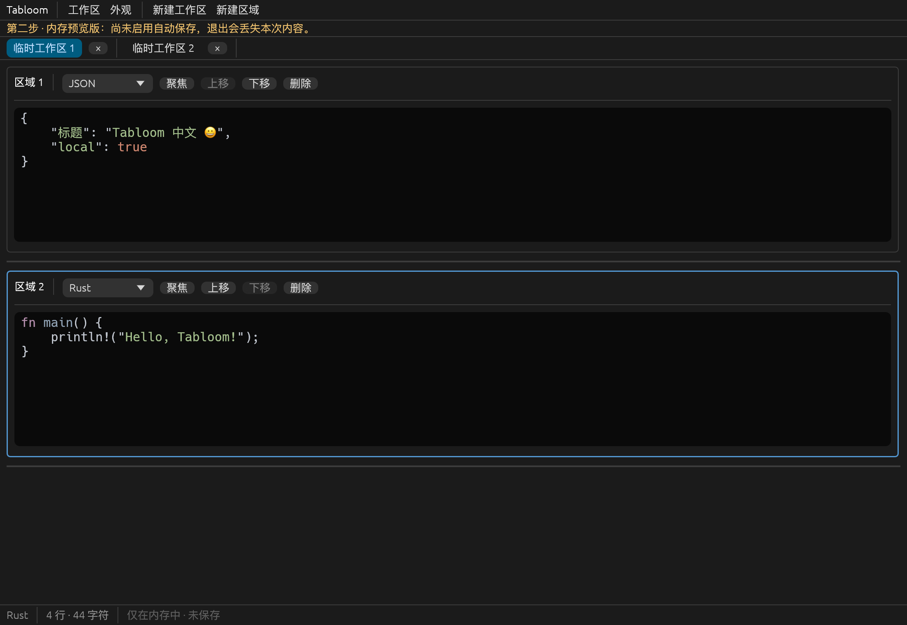

# 第二步核心骨架实施记录

日期：2026-10-21。范围：用户指定的第二步，不提前实现第三步数据库。

## 实际完成

可运行 Rust 原生应用，包含菜单、标签栏、纵向区域、状态栏、中文文案与系统字体回退。新增标签和区域后聚焦可输入；区域支持确认删除、上下移动、拖动高度、独立滚动和语言选择；关闭标签可在当前进程内重开。

默认纯文本。语法注册表按实际语法包检测，19 个选项全部通过存在性测试，包含 PowerShell、TypeScript 和 TOML。日志没有通用规则，明确使用纯文本。高亮只生成显示布局，不写入模型文本；缓存按区域、原始文本、语法、主题、字号和 DPI 变化失效。

区域 UUID 同时作为独立 TextEdit 状态标识。原型增添深浅主题和字号设置；它们尚不持久化。内容仅在内存，顶部持续提示，非空内容退出前整体确认一次。没有数据库或假“已保存”状态。

## 依赖核实

通过 crates.io 的 cargo info、下载后的发布源代码与官方文档核实。Cargo.toml 使用精确版本，Cargo.lock 固定传递依赖。

| 依赖 | 实际版本 | 许可证 | 说明 |
| --- | --- | --- | --- |
| eframe / egui | 0.37.0 | MIT OR Apache-2.0 | MSRV 1.95；Glow 原生渲染，开启 AccessKit、clipboard、system_fonts、X11/Wayland |
| syntect | 5.3.0 | MIT | 默认 Oniguruma 后端；C 源码随 onig_sys 构建 |
| two-face | 0.5.2+bat-0.26.1 | MIT OR Apache-2.0，语法另附许可 | 真实扩展语法包；完整鸣谢已生成并附带 |
| serde | 1.0.229 | MIT OR Apache-2.0 | 模型序列化；MSRV 1.56 |
| uuid | 1.28.0 | MIT OR Apache-2.0 | v4 稳定标识；MSRV 1.89 |
| egui_kittest（开发） | 0.37.0 | MIT OR Apache-2.0 | 无桌面 UI 交互测试；MSRV 1.95 |
| serde_json（开发） | 1.0.154 | MIT OR Apache-2.0 | 模型 round-trip 测试；MSRV 1.71 |
| image（开发） | 0.25.10 | MIT OR Apache-2.0 | 原生冒烟截图输出 |

项目声明 Rust 1.95，实际使用 1.99.1；未在最低 Rust 版本独立构建。syntect 未声明 MSRV，当前工具链的实际编译通过不能证明其他工具链兼容性。

官方资料：[eframe 0.37.0](https://docs.rs/eframe/0.37.0/eframe/)、[syntect 5.3.0](https://docs.rs/syntect/5.3.0/syntect/)、[two-face 语法与后端说明](https://docs.rs/two-face/0.5.2+bat-0.26.1/two_face/)。初次尝试 fancy-regex 时测试发现 PowerShell 缺失，核对上游排除清单后改用 Oniguruma，随后清单全部通过；未将缺失语法伪装为支持。

## 关键文件

| 文件 | 内容 |
| --- | --- |
| `src/main.rs` | 原生窗口启动 |
| `src/app.rs` | UI 组合、标签命令、焦点、快捷键和原型退出确认 |
| `src/model/mod.rs` | 不依赖 GUI 的工作区/区域、关闭重开、排序和序列化 |
| `src/ui/editor_region.rs` | TextEdit、标题栏、语言选择、分隔线拖动 |
| `src/ui/text.rs` | 中文 UI 文案 |
| `src/editor/highlighting.rs` | 语法注册表、syntect 显示层与缓存 |
| `tests/model.rs`、`tests/highlighting.rs`、`tests/ui.rs` | 模型、语法、真实 egui 控件事件测试 |
| `examples/native_smoke.rs` | 真实原生窗口的事件注入与截图验证 |
| `scripts/cargo.sh`、`scripts/macos-app.sh` | 本地工具链入口与 macOS 本地打包 |

## 验证结果

平台：macOS 26.6.2 / ARM64；Rust/Cargo 1.99.1。

| 命令（Cargo 可通过本地脚本调用） | 结果 |
| --- | --- |
| `cargo fmt --all -- --check` | 通过 |
| `cargo check --locked` | 通过 |
| `cargo test --locked` | 17 项通过：模型 7、语法 3、UI 7 |
| `cargo clippy --all-targets --all-features --locked -- -D warnings` | 通过 |
| `cargo build --release --locked` | 通过 |
| `cargo run --example native_smoke -- docs/screenshots/step2-editing.png` | 原生运行通过，输出 NATIVE_SMOKE_OK 并生成截图后退出 |

UI 测试覆盖自动聚焦输入、跨标签内容隔离、区域独立撤销/重做与重排、真实语言菜单、最后区域删除确认、实际指针拖动调高、快捷键不插入多余 Tab、480×360 小窗口可编辑。语法测试覆盖中文/Emoji/Tab/混合换行原样保持、全部目标代码语法、JSON 实际颜色差异。模型测试覆盖归属、排序、关闭重开、活动项、有限高度与全字段序列化恢复。

修复了点击工具栏后焦点被 TextEdit 的“外部点击”判定立即清除的问题：在控件注册交互后申请焦点，回归测试验证连续输入落在新区域。修复了 eframe 新主题 API 的使用，原生截图确认深色主题和中文文本正常。

## 原生 UI 验证边界

应用实际启动过独立二进制和本地 `.app`。尝试用 computer-use 读取系统窗口时，权限查询为 granted，但目标窗口 AX 读取仍返回 permission_denied；没有修改系统权限或将此结果报告为系统交互通过。

改用 eframe 真实原生渲染器和 raw_input_hook 注入文本/快捷键：输入含中文、Emoji、Tab 和 CRLF 的 JSON，增加 Rust 区域并输入，Cmd+N 新建第二标签并输入，通过 Ctrl+Tab 返回第一标签，再验证当前区域撤销/重做且 JSON 区域不受影响。最终截图由渲染器读回像素产生，已人工查看：

这是原生程序中的 egui 事件注入验证，**不是实体键盘、系统中文输入法或系统剪贴板验证**。后者仍需对应桌面环境验收。

## 三平台状态

| 目标 | 已验证 | 未验证 |
| --- | --- | --- |
| aarch64-apple-darwin | 原生 check/test/clippy/release、窗口启动、渲染与 egui 输入事件 | 系统剪贴板、IME、实体键盘流程 |
| x86_64-pc-windows-msvc | 上游原生平台支持说明、Cargo 锁定依赖按平台解析成功 | 原生编译/链接和 GUI |
| x86_64-unknown-linux-gnu | 上游原生平台支持说明、Cargo 锁定依赖按平台解析成功；已选 X11/Wayland features | 原生编译/链接、发行版依赖和 GUI |

三平台分别执行 `cargo metadata --format-version 1 --locked --offline --filter-platform <target>` 成功；依赖解析不是编译证明。当前仅安装 macOS target，没有把本机构建成功等同于三平台通过。

## 尚未实现与下一步

第三步：SQLite、事务、防抖自动保存、持久化最近关闭、重启/崩溃恢复、备份与保存失败反馈。

第四至第六步：独立查找替换面板、完整编辑/剪贴板跨平台验收、文件打开写回导出、窗口恢复、字号快捷键、1MB 性能验证和三平台实际构建。没有默认数据目录或数据库文件，不会自动写入用户文本。
