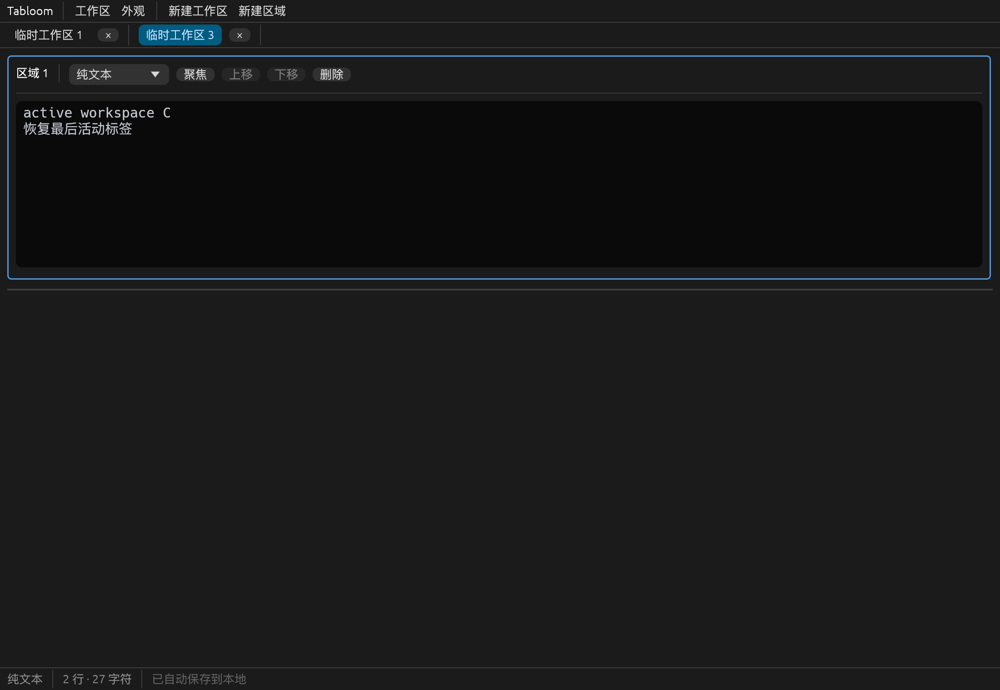
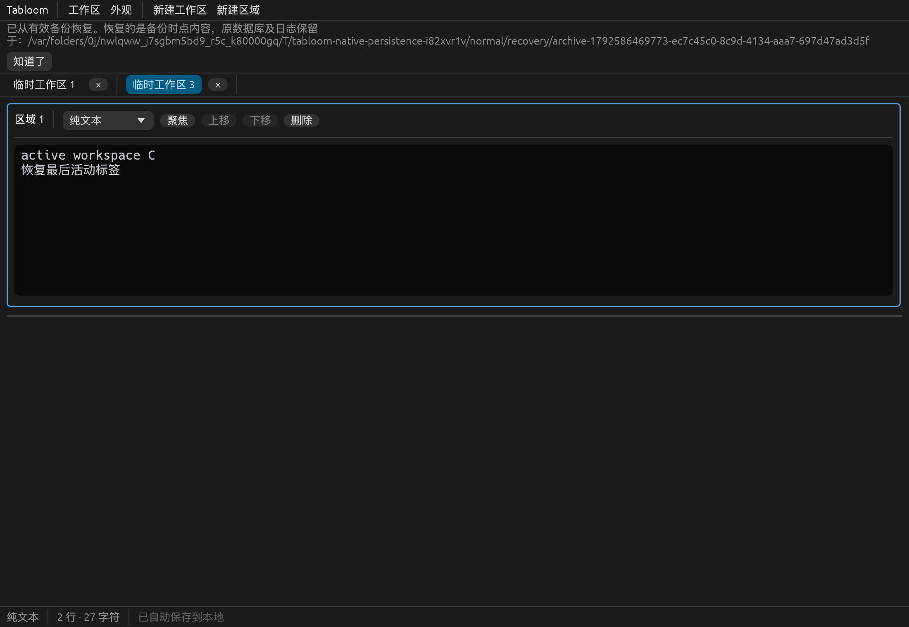

# 第三步：自动保存与恢复

日期：2026-10-21。范围为第三步；没有提前实现查找替换或真实文件打开/导出 UI。

## 实际实现

- 使用操作系统标准用户数据目录，SQLite 采用 bundled 模式，无需额外安装数据库。
- `workspaces`、`regions`、`settings` 关系表；外键、区域和标签排序约束、模型校验、事务保存、`user_version=1` 版本迁移。
- 文本和结构变化约 400ms 防抖，连续输入最长约 2 秒提交一次；revision 防止旧保存完成状态清除新编辑；失败约 3 秒后重试。
- 恢复全部工作区、区域、原始文本、独立语言、顺序、高度、活动标签/区域、最近关闭状态、自动命名计数器、主题、字号和窗口大小。
- 首次启动立即保存初始空白工作区；新增标签及结构变化纳入自动保存。普通关闭应用最终刷新并尝试检查点，不逐个要求另存为；关闭标签只是转为 closed，永久删除需独立确认。
- 保存失败显示持续、非模态错误，保留编辑和未提交状态；可重试或复制完整 JSON 恢复数据。无法完成最终保存时保留窗口，明确放弃才直接退出。
- 已提交内容与备份/检查点维护错误分开呈现。检查点忙并不意味着 WAL 中的事务未保存。
- 标准库跨平台文件锁阻止第二实例写入。启动失败显示错误，不进入会误导用户的空白编辑界面。

## 文件与模块

| 文件 | 职责 |
| --- | --- |
| `src/settings/mod.rs` | 数据路径、400ms/2s/3s 调度默认值、60s 备份间隔、3 份保留、主题和字号默认值 |
| `src/persistence/database.rs` | SQLite 配置、关系表事务、加载校验、备份及检查点 |
| `src/persistence/migrations.rs` | 0→1 事务迁移；拒写未知高版本或不属于本应用的数据库 |
| `src/persistence/autosave.rs` | 可确定性测试的防抖、最长等待、revision 和错误重试调度 |
| `src/persistence/recovery.rs` | 原件归档、一致备份选择、临时恢复库、可续执行的恢复日志 |
| `src/persistence/mod.rs` | 保存协调、主保存与维护错误的独立状态 |
| `src/app.rs` | UI 变化跟踪、隐藏窗口调度、最终保存、错误/重试/恢复提示 |
| `tests/persistence.rs`、`tests/persistence_ui.rs` | 存储及界面集成验证 |
| `examples/persistence_smoke.rs`、`scripts/verify-native-persistence.py` | 隔离临时目录下的原生跨进程验证 |

新增依赖已精确固定到 Cargo.toml/Cargo.lock：rusqlite **0.40.2**（bundled + backup）、directories **6.0.0**、thiserror **2.0.21**；serde_json **1.0.154** 从开发依赖移至正式依赖，新增开发依赖 tempfile **3.27.0**。当前 bundled SQLite 实际为 **3.53.2**，测试检查其版本不低于包含 WAL-reset 修复的版本。文件锁使用 Rust 标准库 `File::try_lock`，未额外引入锁框架。

## 保存与恢复边界

SQLite 启用 WAL、foreign_keys、FULL synchronous 和 200ms busy_timeout。每次保存将完整逻辑快照放在一个事务中替换；插入失败会连同删除一起回滚。没有每帧写库，也没有退出前才首次写库。选择简单同步事务，不增加无必要的异步框架；慢盘或很大工作区的 UI 延迟仍需第六步测量。

自动保存默认只更新内部副本，不写入真实文件。防抖窗口内尚未提交的输入在强杀时可能丢失；已提交 WAL 的异常退出恢复已有真实进程验证。正常退出前必做最后一次保存。窗口隐藏时由 eframe `App::logic` 与单调时钟调度保存，当前未单独进行最小化桌面交互验收。

备份由 SQLite online backup API 生成，验证后发布为独立 `.sqlite3` 文件，保留最近 3 份。编辑期间最多每 60 秒尝试一次，失败也限频；启动和退出会额外尝试，用户可手动重试。失败留下的 `.pending` 文件不作为有效备份选择，不自动删除诊断文件。

启动以只读方式检查主库；只有明确的 SQLite 损坏/应用数据无效才进入恢复。权限、占用、未知版本、不属于本应用的库不被当作损坏后重建。确认损坏后先复制原始主库及存在的 WAL/SHM 到唯一归档目录，再验证候选备份；选择最新有效备份，生成临时恢复库和同步到磁盘的恢复日志，最后替换。中途退出后根据日志续执行，避免把临时缺失的主库当作首次启动而初始化空库。

无有效备份时保留原件并停止进入编辑器，不承诺 salvage 任意坏页。备份恢复的是备份时点的数据，无法保证包含最后一次成功编辑；界面会明确提示。Unix 使用目录 fsync，Windows 标准库路径没有等价目录 fsync，实际断电行为尚未在 Windows 验证。

## 默认数据位置

使用 `ProjectDirs::from("org", "tabloom", "Tabloom").data_local_dir()`：

| 平台 | 路径 |
| --- | --- |
| macOS | `~/Library/Application Support/org.tabloom.Tabloom/` |
| Windows | `%LOCALAPPDATA%\tabloom\Tabloom\data\` |
| Linux | `$XDG_DATA_HOME/tabloom/`，无该设置时 `~/.local/share/tabloom/` |

主库为 `tabloom.sqlite3`，快照位于 `backups/`，损坏原件位于 `recovery/archive-*/`。测试使用临时目录，不向默认用户目录写入测试文本。

## 自动化验证

平台：macOS 26.6.2 / ARM64，Rust/Cargo 1.99.1。

| 检查 | 结果 |
| --- | --- |
| `cargo fmt --all -- --check` | 通过 |
| `cargo check --locked` | 通过 |
| `cargo test --locked` | 42 项通过：模型 7、语法 3、基础 UI 7、存储集成 15、存储 UI 7、数据库内部故障测试 3 |
| `cargo clippy --all-targets --all-features --locked -- -D warnings` | 通过 |
| `cargo build --release --locked` | 通过 |

覆盖无库初始化、完整 snapshot 销毁后重载、Unicode/混合换行、活动标签/区域、语言/顺序/高度和设置、最近关闭重开、永久删除级联和其他标签隔离。

失败验证使用真实 SQLite 行为：触发器在插入中途 ABORT 验证事务回滚；max_page_count 限制触发真实 SQLITE_FULL，确认旧事务完整、内存编辑保留、解除限制后重试成功；读事务阻止检查点，确认已提交内容仍标记已保存。界面测试确认错误可见、继续输入、恢复副本输出为纯文本 JSON、失败关闭被取消，以及正常关闭无保存弹窗。

备份/恢复测试覆盖未检查点的 WAL 快照、保留份数、损坏主库及原始日志逐字节保留、跳过坏备份、无备份不清空原库、主库丢失时恢复、恢复中断续执行、未知 schema 拒写、权限/路径错误不进入破坏性恢复、双实例保护，以及自动保存不改变外部文件字节。

## 原生跨进程验证

执行：

```sh
python3 scripts/verify-native-persistence.py --screenshots docs/screenshots
```

脚本在新建临时目录中启动原生 eframe 窗口，通过 egui 事件输入中文、Emoji、Tab、混合换行和 SQL；新建三个工作区、关闭其中一个，重排区域并调整高度，等待自动保存后生成完整预期快照。

1. writer 正常关闭，reader 新进程启动，全部字段相等，无逐个保存对话框。
2. 故意破坏测试主库，reader 启动时从有效备份恢复，全部字段相等，显示恢复通知和归档路径。
3. 独立 writer 在自动保存后直接 `process::exit(23)`，绕过 App::on_exit 和 Connection::drop；确认留下未检查点 WAL，再启动 reader，全部字段相等。

本次首次正常 writer 从窗口开始到完成输入及自动保存约 **0.79 秒**，异常退出 writer 约 **0.55 秒**。这是完整冒烟流程用时，不是通用存储性能承诺。所有五次原生进程运行的预期退出码及断言通过，输出 `NATIVE_PERSISTENCE_SCENARIOS_PASS`。






这是实际原生渲染器与进程边界验证；输入由 egui 事件注入，不代替实体键盘、IME 或三平台系统剪贴板验收。

## 尚未完成

第四步查找替换及完整编辑/剪贴板快捷键验收、第五步真实文件互操作、窗口位置恢复、第六步三平台实际构建和 1MB 编辑性能验证仍待实施。当前仅 macOS 原生构建/运行通过，Windows/Linux 没有被描述为验证通过。

恢复副本目前可复制 JSON 后粘贴到外部文件，尚无 JSON 导入界面。跨进程恢复不还原撤销栈和光标选区。原件归档不会自动清理；永久删除当前工作区不会抹除已有备份和归档中的旧副本。

## 实现依据

- [SQLite WAL](https://www.sqlite.org/wal.html) 与 [损坏风险说明](https://www.sqlite.org/howtocorrupt.html)：WAL、FULL synchronous 与相关修复信息。
- [SQLite Online Backup API](https://www.sqlite.org/backup.html)、[rusqlite backup](https://docs.rs/rusqlite/0.40.2/rusqlite/backup/index.html)：一致性快照接口。
- [directories ProjectDirs](https://docs.rs/directories/6.0.0/directories/struct.ProjectDirs.html)：平台标准目录。
- [Rust File 文件锁](https://doc.rust-lang.org/std/fs/struct.File.html#method.try_lock)：跨平台标准库锁，稳定于 Rust 1.89，低于本项目声明的 1.95。
