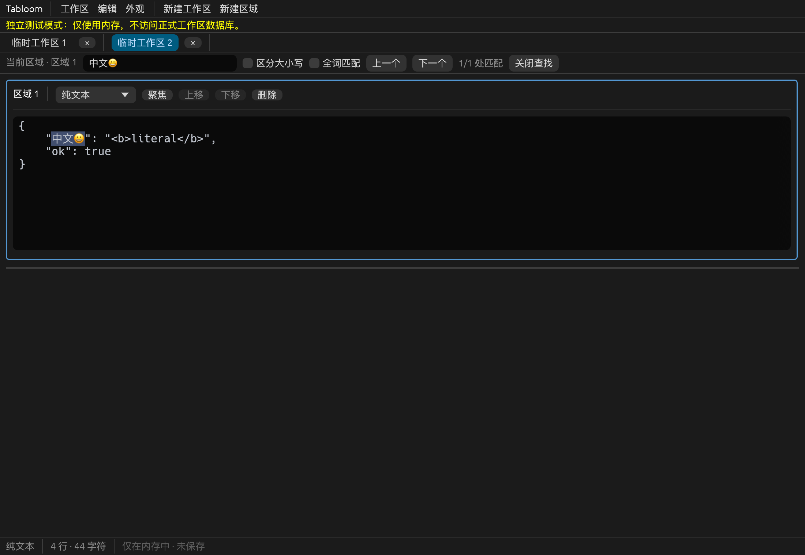

# 第四步：纯文本剪贴板与基础编辑

日期：2026-10-21。承接第三步，在现有多工作区、SQLite 自动保存基础上实施；本阶段未增加真实文件互操作。

## 实际功能

- 当前区域字面查找、大小写、Unicode 全词匹配、计数、当前匹配高亮、前后循环导航、替换当前及全部替换；替换可撤销/重做，文本中的 `$1` 和反斜杠不作表达式展开。
- egui 原有输入、选择、撤销重做继续使用，补齐 PageUp/PageDown 和 Shift 翻页选区；Tab 输入，选中多行 Tab 缩进，Shift+Tab 减少缩进，保留 CRLF/LF/CR。
- 纯文本剪贴板通过 arboard 3.7.0；禁用 egui-winit 默认的剪贴板快捷键转换，避免默认粘贴路径把 CRLF 转成 LF。读取错误和写入错误可见，剪切先验证复制成功再删除选区。
- 菜单编辑命令针对最后聚焦的输入框，包含查找和替换框，防止误修改区域。保留失焦选区，修复 egui 在菜单获得 IME 所有权后折叠选区的问题。
- 为快速粘贴/剪切建立撤销边界；原生验证曾发现默认输入合并导致快速剪切不能一次恢复，现已修复并复验。
- 字号快捷键 10–32，持久化沿用已有 preferences；菜单显示对应平台组合键。macOS 替换采用 Cmd+Shift+H，避免占用系统 Cmd+H；应用标签切换继续采用 Ctrl+Tab。

## 代码边界

| 文件 | 职责 |
| --- | --- |
| `src/editor/clipboard.rs` | 文本选区提取、可测试剪贴板接口、arboard 桥接、egui 输入输出插件、错误反馈 |
| `src/editor/search.rs` | regex 1.13.1 的转义字面查询、Unicode 选词边界、UTF-8 范围、替换及缓存 |
| `src/editor/commands.rs` | egui 现有光标/撤销状态适配、原子替换、缩进及菜单命令 |
| `src/editor/highlighting.rs` | 只读高亮布局，按当前匹配范围设置背景，不修改源文本 |
| `src/ui/find_replace.rs` | 查找替换面板、查询/替换框焦点及命令 |
| `src/ui/editor_region.rs` | 区域编辑、翻页、独立选区、焦点恢复、分隔线拖动 |
| `src/ui/shortcuts.rs` / `src/ui/text.rs` | 平台快捷键和集中界面文案 |
| `src/app.rs` / `src/main.rs` | 菜单调度、命令目标、快捷键消费、剪贴板插件安装 |

没有引入新数据库表或 schema 迁移；替换操作复用已有 dirty 跟踪和自动保存。查找状态属于临时 UI 状态，未持久化。

## 验证

自动化测试共 **63 项**：第三步的 42 项回归，加 6 项搜索/选区测试和 15 项真实 egui 交互测试。新增覆盖字面元字符、Unicode 大小写折叠、组合字符词边界、UTF-8 非法范围保护、原文选区提取、复制/剪切/粘贴与失败反馈、无选区、区域隔离、菜单焦点/选区、查找框撤销、替换撤销、替换后数据库恢复、缩进、光标移动、翻页和字号保存。Mac/Windows/Linux 的快捷键分支由无桌面 egui 测试覆盖。

本机执行以下检查：

```sh
./scripts/cargo.sh fmt --all -- --check
./scripts/cargo.sh check --locked
./scripts/cargo.sh test --locked
./scripts/cargo.sh clippy --all-targets --all-features --locked -- -D warnings
./scripts/cargo.sh build --release --locked
python3 scripts/verify-native-persistence.py
```

结果：格式检查、`cargo check`、63 项测试、严格 clippy 和 release 构建均通过；`.app` 已重新生成。原生跨进程持久化的正常关闭、损坏主库恢复备份、未检查点 WAL 异常退出恢复场景均通过。Windows（208 个包）与 Linux（291 个包）的 `cargo metadata --locked --offline --filter-platform …` 依赖解析通过；这不是目标平台编译。

macOS 系统剪贴板验证入口：

```sh
./scripts/cargo.sh build --example clipboard_smoke --locked
swift scripts/verify-native-clipboard.swift "$PWD/target/debug/examples/clipboard_smoke" "$PWD/docs/screenshots/step4-clipboard.png"
```

真实窗口中从含 HTML/RTF 替代表示的系统剪贴板粘贴测试文本，断言中文、Emoji、Tab、CRLF/LF/CR 完全一致；复制、剪切、撤销、新标签粘贴均断言通过。AppKit 检查最终剪贴板格式仅 `public.utf8-plain-text` 与 `NSStringPboardType`，没有 HTML/RTF/图像。脚本仅在内存保留原剪贴板，执行完恢复，避免写入文件或打印原剪贴板内容。探针绕开正式数据库。截图为真实渲染，快捷键是 egui 事件注入。



## 平台与限制

实际构建和运行平台仅 macOS ARM64，Rust 1.99.1；Windows/Linux 尚未实际编译或运行系统剪贴板测试，不能视为已完成三平台验收。MSRV 仍为 1.95，锁文件固定实际依赖。arboard 禁用图像功能，Linux 启用 Wayland data-control 支持并保留 X11；原生行为仍需对应桌面验证。

本阶段不含文件打开/导出/写回及 Ctrl/Cmd+S；下一阶段实现。查找仅提供字面模式和单行输入框，未实现正则、跨区域查询、全部匹配同时高亮及查询配置恢复。撤销栈未持久化；实体键盘、中文输入法、Windows/Linux 桌面及大文件性能尚未验收。查找全词规则以 Unicode 字母/数字/下划线/组合标记为词字符，连续中文视为一个词。
