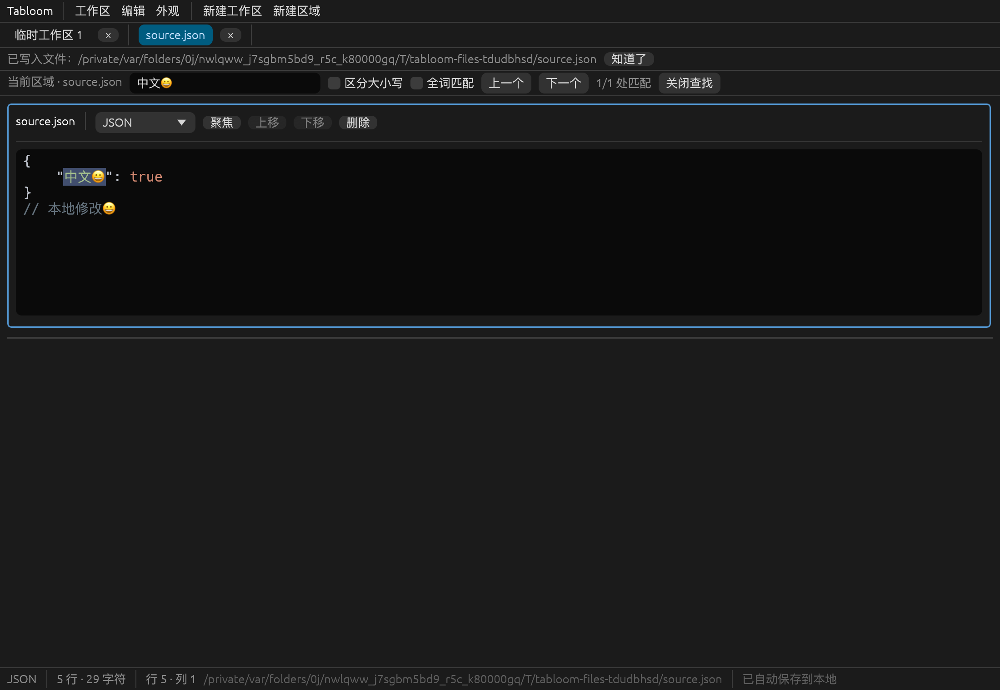
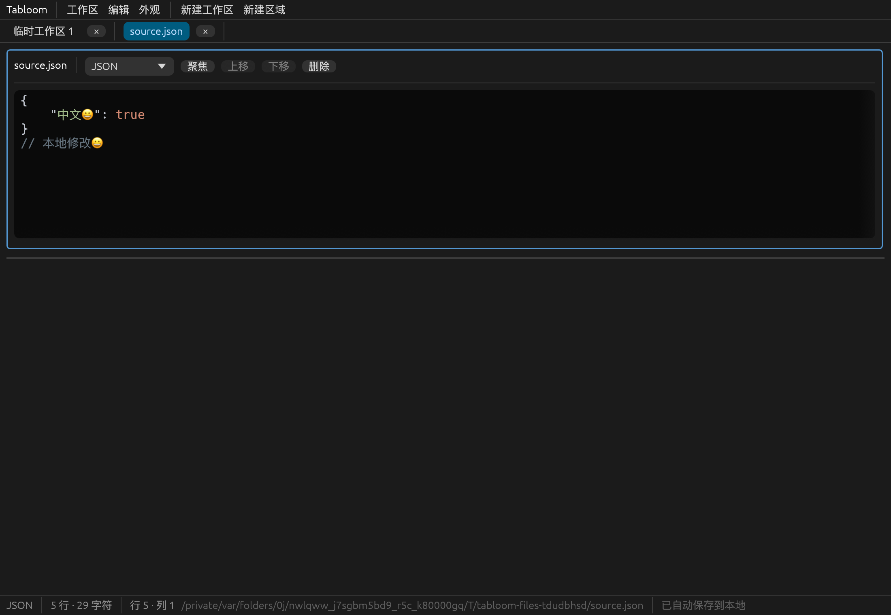

# 第五步：真实文件互操作和界面完善

日期：2026-10-21。承接第四步实施，新增真实文件操作；保持内部自动保存与真实文件写回相互独立。本步骤完成，第六步的完整跨平台和性能验收尚未完成。

## 已实现的行为

- “工作区”菜单及 Ctrl/Cmd+O 打开系统文件选择器；取消不新增工作区。打开成功后以独立工作区、一个区域承载文本，显示文件名，记录真实路径。扩展名只建议初始语法，不妨碍覆盖语言。
- 严格支持 UTF-8、UTF-8 BOM、带 BOM 的 UTF-16 LE/BE；BOM 不混入编辑文本，保留中文、Emoji、Tab 和 CRLF/LF/CR。无效编码、UTF-32、NUL 疑似二进制报错，不用有损转换。
- Ctrl/Cmd+S 对当前活动区域生效，查找框有焦点也不改变目标。关联文件先提交内部副本，再按原编码/BOM 写回；临时区域只提交内部数据库并提示已自动保存，不弹强制另存为。
- 显式“导出当前区域（UTF-8）”才使用保存选择器，写出不带 BOM 的 UTF-8 副本，不创建文件关联。选择原关联路径时遵守原编码保存及冲突检测规则。
- 关联文件的编码和 SHA-256 指纹随工作区恢复；磁盘内容变化或删除会拒绝覆盖。内存和数据库中的本地内容保持可恢复，可以导出另一路径或重新打开磁盘版本比较。
- 写入采用同目录临时文件、内容 sync、替换前再次核验指纹、最后替换。普通文件权限位保留；通过符号链接打开时解析到目标，保存不替换原符号链接。失败不静默清除错误或改报成功。
- 写回前内部恢复副本保存失败会阻止覆盖原文件；显式导出到其他路径仍可作为应急副本，并保留内部失败状态。若真实文件已写入而后续关联状态落盘失败，会明确说明这一顺序。
- 应用数据根目录及其中的备份/恢复目录受到路径保护，不允许作为普通文本打开或覆盖。SQLite 文件头也不会被解码为普通文本。
- 状态栏补充当前区域光标行列和关联路径。深浅主题、字号和窗口大小恢复沿用现有实现。

## 结构与版本

| 文件 | 本阶段职责 |
| --- | --- |
| `src/file_io/mod.rs` | 严格编解码、路径解析与保护、指纹、冲突检测、分阶段写入、语言建议 |
| `src/model/mod.rs` | GUI 无关的 TextEncoding / FileState，区域独立文件关联 |
| `src/persistence/migrations.rs` | schema 1 → 2 事务迁移，新增可空 file_state_json |
| `src/persistence/database.rs` | 保存文件元数据；只读检查兼容 schema 1 的主库和备份 |
| `src/app.rs` | 文件命令、当前区域定位、恢复副本提交、错误与对话框生命周期 |
| `src/ui/text.rs` | 文件菜单、错误提示、状态栏文案 |
| `tests/file_io.rs` | 编码、文件字节、冲突、路径与权限测试 |
| `tests/file_workflow.rs` | 文件/工作区/数据库集成和真实 egui 快捷键测试 |
| `examples/file_smoke.rs` / `scripts/verify-native-files.py` | 隔离原生窗口与跨进程文件流程 |
| `examples/file_dialog_smoke.rs` | macOS 真实打开/保存面板的弹出及取消验证 |

新增正式依赖 rfd **0.17.2**（MIT）、sha2 **0.11.1**（MIT/Apache-2.0），tempfile **3.27.0** 从测试依赖提升为正式依赖用于分阶段写入。版本在 Cargo.toml 固定，Cargo.lock 已更新。macOS 面板测试另使用现有图中的 objc2/objc2-app-kit/dispatch2 开发依赖，产品不依赖该测试代码。

选型依据为 [rfd 官方平台与后端说明](https://docs.rs/rfd/0.17.2/rfd/) 和 [RustCrypto sha2 API](https://docs.rs/sha2/0.11.1/sha2/)，并核查实际下载源码和 Cargo features。rfd 默认使用 Linux XDG Desktop Portal/Wayland，不引入 GTK3 编译后端；运行时需要会话 D-Bus 和 portal 服务及桌面后端。sha2 声明 MSRV 1.88，项目 MSRV 保持 1.95。本次实际工具链为 macOS ARM64 Rust 1.99.1。

SQLite 当前 schema 为 **2**，新增字段在事务中升级，旧文本、布局和设置保留。schema 1 备份可先检查、恢复，再迁移。旧关联只有路径没有指纹时拒绝盲写，需重新打开或导出。

## 自动化验证

共 **79 项测试通过**：第四步 63 项回归，加本阶段 7 项文件测试和 9 项文件工作流测试。新增覆盖：

- 四种编码的 BOM/Unicode/混合换行往返；无效 UTF-8、奇数字节 UTF-16、孤立代理项、UTF-32/NUL/数据库拒读。
- 文件打开、原编码保存、UTF-8 导出、重启恢复关联、临时区域保存不要求命名。
- 外部修改和删除的冲突保护、重复保存后指纹更新、目录/不存在路径错误、无临时文件残留。
- Unix 权限位保留、符号链接目标解析、数据目录及其符号链接别名保护。
- 打开失败不增标签；其他标签保持原样；内部副本保存不修改原文件。
- SQLite 写事务被阻塞时，不覆盖原文件且保持 dirty；仍能应急导出，失败提示不被清除。
- schema 1 主库无损升级、损坏主库从 schema 1 旧备份恢复再升级。
- 查找框焦点下 Ctrl/Cmd+S 保存当前区域；冲突可见、本地修改重启可恢复。

执行并通过：

```sh
./scripts/cargo.sh fmt --all -- --check
./scripts/cargo.sh check --locked
./scripts/cargo.sh test --locked
./scripts/cargo.sh clippy --all-targets --all-features --locked -- -D warnings
./scripts/macos-app.sh release
```

macOS release 原生二进制与 `.app` 已重新生成。打包脚本原子替换 bundle 中的可执行文件，不改写正在运行的旧程序 inode。旧窗口须正常退出、重启才能使用新版本；没有结束用户已有进程或修改正式工作区内容。

## 原生运行验证

```sh
python3 scripts/verify-native-files.py
./scripts/cargo.sh run --example file_dialog_smoke --locked
python3 scripts/verify-native-persistence.py
./scripts/cargo.sh build --example clipboard_smoke --locked
swift scripts/verify-native-clipboard.swift "$PWD/target/debug/examples/clipboard_smoke" "$PWD/target/step5-clipboard.png"
```

文件探针在临时目录创建 UTF-16 LE 源文件，启动真实 eframe/Glow 窗口，验证输入后内部副本可提交但原文件未变，再从查找框通过保存快捷键写回、UTF-8 导出。第二进程恢复本地编辑，模拟磁盘外部修改后拒绝覆盖。结果 `NATIVE_FILE_SCENARIOS_PASS`。

macOS 对话框探针真实调用 rfd 的打开与保存面板，AppKit 主队列确认自己的模态窗口存在，再自动取消，返回 None，结果 `NATIVE_FILE_DIALOG_OK`。不依赖辅助功能权限，不控制其他应用；仅测试弹出/取消，人工选取文件和覆盖确认仍需桌面验收。

持久化原生回归覆盖正常退出、故意损坏测试主库后的备份恢复、异常退出后的 WAL 恢复，结果 `NATIVE_PERSISTENCE_SCENARIOS_PASS`。真实 macOS 剪贴板回归也通过，保留中文/Emoji/Tab/混合换行，最终仅纯文本格式。





所有探针使用隔离临时数据，未访问或破坏正式数据库；截图来自原生渲染。输入/快捷键由 egui 事件注入，不等于实体键盘或中文输入法验证。

## 平台证据与限制

实际构建、运行平台只有 **macOS ARM64**。Windows MSVC 的 217 个包和 Linux GNU 的 301 个包通过 `cargo metadata --locked --offline --filter-platform …` 依赖解析；没有实际目标平台编译/链接或桌面运行，不能声称三平台已经验收。

- 无 BOM 的 UTF-16、其他旧编码及含 NUL 文件不支持；没有编码切换、强制覆盖、自动合并或外部文件监视。
- 导出仅针对当前区域，暂不导出整个工作区。打开相同文件会创建独立工作区，各自保存时仍受指纹冲突保护。
- SHA-256 检查不等于跨进程锁；最后一次检查与替换之间仍有竞态。分阶段替换保留权限位，不保证保留 ACL、扩展属性、硬链接关系或断电时的目录项耐久性。
- 大文件同步读取/编码及文件选择器会短暂占用 UI 线程；选择器前尝试提交待保存副本。尚无 1MB 性能测量，不宣称无限文件大小或无限区域性能。
- Windows/Linux 的原生构建、文件框、系统剪贴板，及实体键盘/输入法仍待第六步相应环境验证。
