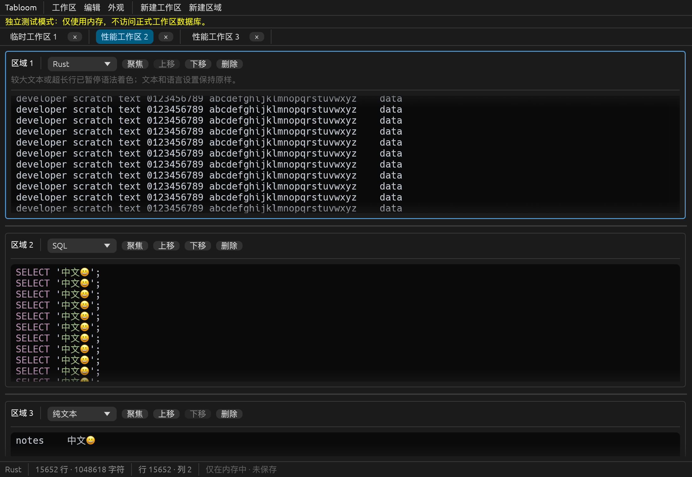
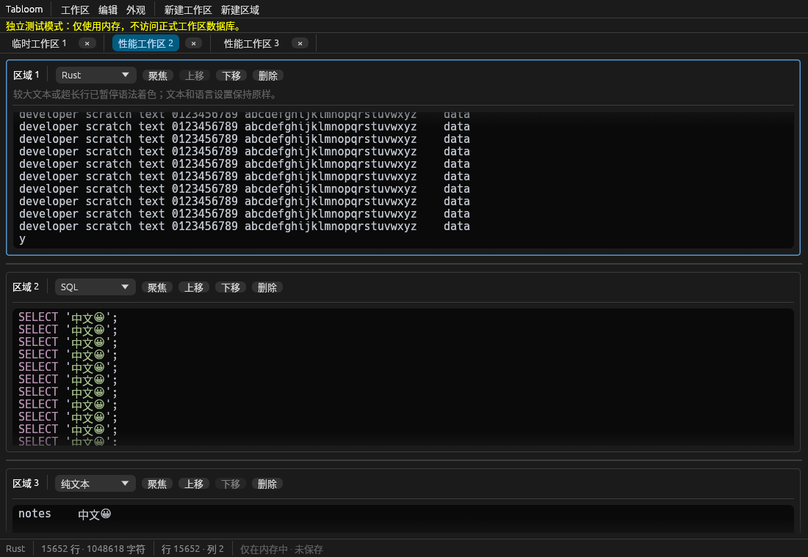

# 第六步：验收、性能与交付

日期：2026-10-22。本阶段执行自动化与原生回归，进行约 1MiB 文本测量，修复大文本同步语法解析开销，补充三平台 CI 配置和 Linux 容器验证入口。

当前交付为可运行的核心候选版；Windows 原生、Wayland 和实体键盘/输入法尚未验收，不宣称三平台全部完成。对应历史功能见第二至第五步报告，以下是本轮重新执行的验证。

## 本轮改动

- 纯文本 LayoutJob 直接构建，跳过 syntect 逐行解析。
- 非纯文本超过 256KiB 或单行超过 16KiB 时暂停语法着色，显示明确提示，保留原文本与该区域语言配置；文本缩小后自动恢复着色。阈值用于限制同步解析，**不是文件或编辑大小上限**。
- 增加纯函数及 egui UI 回归，验证降级提示可见、语言及文本不变、缩小后提示消失。
- 新增可重复的 release 性能探针和真实窗口 1MiB 输入/标签切换/撤销重做探针。
- 原生验证脚本支持 CARGO_TARGET_DIR，便于隔离 Linux 构建目录。
- `.github/workflows/ci.yml` 配置 Windows/macOS/Linux 原生 check/test/clippy/release，以及 Linux X11 原生探针。仅落盘配置，未推送或运行远程 CI；当前目录没有 Git 仓库。
- 新增 Linux 验证 Dockerfile、脚本和独立 X11 剪贴板探针。

关键文件：`src/editor/highlighting.rs`、`src/ui/editor_region.rs`、`examples/performance.rs`、`examples/large_text_smoke.rs`、`scripts/verify-linux-container.sh`、`.github/workflows/ci.yml`。应用主体仍为 Rust/eframe；持久化、文件、搜索和剪贴板模块边界保持独立。

## macOS 构建和测试

环境：macOS ARM64，Darwin 25.6.0，16GiB RAM，Rust 1.99.1，Glow/OpenGL。本轮 **81 项自动化测试通过**（原 79 项，加 2 项大文本降级回归）。执行：

```sh
./scripts/cargo.sh fmt --all -- --check
./scripts/cargo.sh check --all-targets --locked
./scripts/cargo.sh test --locked
./scripts/cargo.sh clippy --all-targets --all-features --locked -- -D warnings
./scripts/macos-app.sh release
```

以上均通过。release 二进制和 `target/release/Tabloom.app` 已生成；没有结束用户已有应用进程，新行为需正常退出旧版窗口后重启。

自动化覆盖完整的新建工作区→多区域→不同语言/文本→重排/调高→事务保存→销毁状态→恢复逐字段核对，也覆盖关闭/重开/永久删除隔离、错误和回滚、旧 schema 与备份恢复、文件及剪贴板边界。

本轮实际运行以下原生探针并通过：

```sh
python3 scripts/verify-native-persistence.py
python3 scripts/verify-native-files.py
./scripts/cargo.sh run --example native_smoke --locked -- target/step6-native.png
./scripts/cargo.sh run --example file_dialog_smoke --locked
./scripts/cargo.sh build --example clipboard_smoke --locked
swift scripts/verify-native-clipboard.swift "$PWD/target/debug/examples/clipboard_smoke" "$PWD/target/step6-clipboard.png"
./scripts/cargo.sh build --release --example large_text_smoke --locked
./target/release/examples/large_text_smoke target/step6-large-plain.png
./target/release/examples/large_text_smoke target/step6-large-rust.png rust
```

原生验证包含正常退出恢复、故意损坏隔离主库后恢复备份、绕过退出钩子的异常退出/WAL 恢复、多标签多区域语言与撤销隔离、真实文件导入/保存/导出及重启冲突保护、系统文件对话框弹出/取消、真实 macOS 纯文本剪贴板格式与换行验证。

异常退出仍可能丢失最后未提交的编辑：正常事件循环下约 400ms 防抖，连续输入最长约 2s 请求保存；繁忙 UI 或阻塞 IO 可能延后调度。已提交的 WAL 在下一进程恢复。自动恢复不承诺最后一个未提交字符永不丢失。测试进程报告了约 0.5–0.8s 的保存观测时间，含帧调度。

## 性能测量

重复入口：

```sh
./scripts/cargo.sh run --release --example performance --locked
```

固定样本每个大区域 **1,048,617 字节**，三个工作区，每工作区三个区域：一个约 1MiB 普通文本，两个较小的 SQL/Unicode 笔记区域；数据库约 3MiB 文本。所有测量均验证内容和隔离正确，不只计时。原始数据见 [优化前](measurements/step6-before.json)、[优化后](measurements/step6-after.json) 和 [原生 UI](measurements/step6-native-macos.json)。

| 项目 | 优化前 | 优化后 |
| --- | ---: | ---: |
| 1MiB 纯文本 LayoutJob | 6.08ms | 0.15ms |
| 1MiB Rust LayoutJob | 203.25ms，完整解析 | 0.16ms，暂停着色 |
| 3 工作区数据库快照保存 | 7.87ms | 12.67ms |
| 数据库读取 | 0.68ms | 0.76ms |
| 1MiB 字面查找 | 1.08ms | 1.11ms |
| headless 初次 UI 构建 | 75.32ms | 71.80ms |
| headless 三次输入 run | 63.49–70.82ms | 63.50–67.99ms |
| headless 切换工作区 run | 131.46ms | 119.26ms |

这不是统计基准或性能承诺。数据库时间受到并发构建/磁盘负载影响，不能据两次采样宣称提升或退化。Rust 的差异来自明确的着色降级，并非同等完整高亮突然加速。headless 的 run 包含 kittest 多个稳定帧，不包含系统字体及原生绘制。

真实 eframe/Glow 窗口的同等 3×3 区域场景通过快速输入、标签往返、独立撤销/重做；warmed `app.show` CPU 时间约 0.8–5.7ms，首次构建观测约 19–210ms。此计时不包含整帧 GPU/合成器成本，不能换算成端到端输入延迟或 FPS。只测量本固定样本，没有测量超大文件、恶意语法或所有屏幕布局，不宣称无限文件大小/区域数量。



## Linux 与 CI

Linux 容器验证入口：

```sh
./scripts/verify-linux-container.sh
```

使用公共官方 Rust 镜像、Debian bookworm 本机 ARM64 构建，源码只读挂载，产物在 `target/linux/`，独立 Cargo registry 缓存和临时数据目录。Xvfb、Mesa 软件渲染与 xclip 提供隔离 X11 环境，不接触宿主机正式数据或剪贴板。首轮 Docker Hub 拉取遇到证书域名错误；未关闭证书验证，改用公共 ECR 的官方镜像副本后继续。

CI Linux 库清单参考 [eframe 官方构建说明](https://github.com/emilk/egui/blob/main/crates/eframe/README.md)，另按实际 features 加入 Fontconfig、Wayland 和 X11 开发库；[checkout 版本](https://github.com/actions/checkout/releases) 固定为 v7.0.1。workflow YAML、shell 语法和 Python 脚本语法检查通过，这不代表远程 runner 已经执行成功。

Linux 已通过 Rust 1.99.1 的格式检查、all-targets check、81 项测试、严格 clippy，以及 GNU/Linux ARM64 ELF 实际链接。Xvfb/Mesa 下的正常/异常退出恢复、文件导入/保存/导出、X11 系统剪贴板与三个 1MiB 工作区的输入/切换/撤销/重做均通过。最终脚本退出码为 0；另用真实主程序（不是探针包装器）启动隔离标准数据目录，确认进程保持运行、自动初始化一个工作区及有效 schema 2 SQLite，结果 `LINUX_MAIN_STARTUP_PASS`。产物为 `target/linux/debug/tabloom`。未构建 Linux release 包。原始结果汇总见 [Linux 验证数据](measurements/step6-linux.json)。

容器 VM 内存约 1GiB，首次并行 GNU BFD 链接被 OOM 终止。验证脚本改为单任务、关闭 dev/test 调试符号，并使用 Rust 自带 LLD；仍执行正常断言和测试。正式项目 Cargo profiles 未修改。真实 X11 启动暴露了编译检查无法发现的 `libxkbcommon-x11` 动态库缺项，已补到镜像和 CI 清单，同时加入 Emoji 字体。

| 平台 | 构建/测试 | GUI 与剪贴板 | 未验证 |
| --- | --- | --- | --- |
| macOS ARM64 | debug/release；81 项测试；clippy | 原生 Glow；系统纯文本剪贴板；文件与恢复；1MiB | 实体键盘/输入法、人工文件选取 |
| Linux ARM64 / Debian bookworm | debug ELF；81 项测试；clippy | Xvfb/Mesa X11；真实剪贴板；文件/恢复/1MiB 通过 | Wayland、硬件 GPU、真实桌面选择器 |
| Windows MSVC | 仅依赖解析和 CI 配置 | 尚未运行 | 原生构建与桌面验收 |
| Linux x86_64 | 仅依赖解析和 CI 配置 | 尚未运行 | 对应架构编译与桌面验收 |



## 验收边界

- 单标签多区域、区域独立语法、编辑/撤销、排序/高度、自动保存和恢复：本机测试通过。
- 最近关闭、永久删除确认、其他工作区不受影响：自动化和原生恢复验证通过。
- 复制纯文本、基础编辑、查找替换、真实文件互操作、保存错误可见：macOS 和 Linux X11 已验证；系统选择器弹出/取消仅 macOS 实测，平台差异单独记录。
- 启动/构建：macOS release 通过；其他平台见上方矩阵，不以依赖解析替代实际链接。
- Windows、Wayland、实体键盘/中文输入法、人工文件选择/覆盖确认和签名发布包：尚未完整验收。
- 沿用第五步限制：无编码切换、文件监视/合并、整个工作区导出；不持久化撤销栈/选区；文件原子替换的 ACL/扩展属性/并发写入限制见 README。

因此交付是可启动使用的核心候选版，尚不能把“Windows/macOS/Linux 完整原生桌面验收”标为完成。
