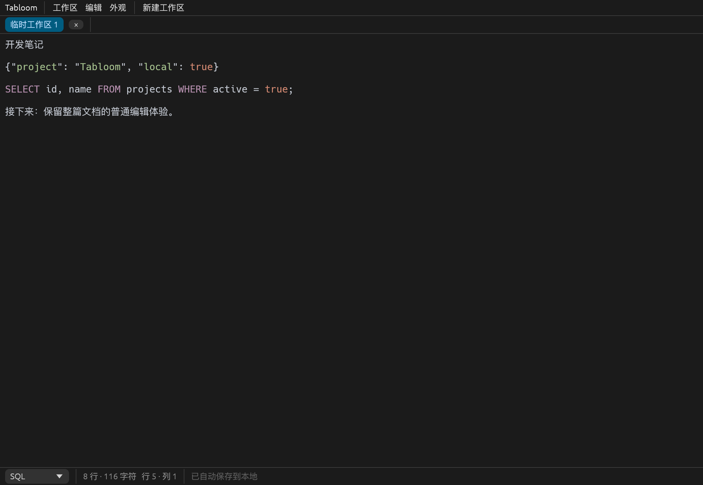

# 连续文档与隐式区域优化

日期：2026-10-22。此记录替代早期报告中关于区域卡片、分隔线、独立区域滚动、区域级撤销及区域内查找的界面描述，其他历史验证仍保留其原有范围。

## 使用结果

每个标签只有一个 egui TextEdit，显示为普通文档。区域标题栏、边框、拖动分隔线及常驻新增区域按钮已经移除。JSON、SQL 等语法范围共享光标、选区、滚动条及文档撤销栈，能够直接跨范围拖选、复制、剪切与替换。

从行首完整选中一行或多行，通过右键或“编辑 → 将选中整行设为区域”转换，再在状态栏切换语言。可以不选最后一行的换行符，内部会包含对应完整 LF、CRLF 或 CR；部分行不能转换。转换继承原有语言，保留文本的每个字节，不插入 UI 分隔文本。



## 实现位置

- `src/model/document.rs`：完整行校验、区域拆分、连续文本映射；基于游标位置处理重复字符，借助 similar 的 Unicode 字符差异映射跨范围批量修改。
- `src/ui/editor_region.rs`：唯一无边框文档编辑器；将各范围的 syntect 显示结果组合；缓存布局、按文本指纹记录区域元数据，文本撤销后恢复语言边界。元数据快照只存长度与属性，并保留 egui 中仍可到达的撤销检查点。
- `src/app.rs`：菜单转换、状态栏语言选择、文档查找替换与全局选区、同源文件完整保存。
- `src/ui/text.rs`：集中中文文案。
- `tests/document.rs`、`tests/ui.rs`、`tests/editing_ui.rs`、`tests/file_workflow.rs`：边界、交互、跨区域文本操作及文件恢复回归。
- `examples/document_smoke.rs`：真实原生渲染与临时 SQLite 保存重载探针，自动生成截图后退出。

SQLite schema 仍为 2，无需重写旧数据。旧区域按顺序直接拼接，保留原文本；原区域高度字段保留兼容但不再控制显示。多个片段仍使用稳定 UUID、独立语言及原有自动保存机制。

打开真实文件后拆分区域，会保留原文件路径和编码。Ctrl/Cmd+S 将本标签中属于同一路径的所有片段按顺序拼接写回，更新所有片段的文件指纹。跨不同来源文件的区域转换会明确拒绝，避免混淆关联。自动保存仍只写内部数据库。“导出当前区域”仍导出光标所在语法范围；它与关联文件的完整写回语义不同。

## 自动化与原生验证

macOS ARM64：`cargo fmt --all -- --check`、`cargo check --all-targets --locked`、`cargo test --locked`、`cargo clippy --all-targets --all-features --locked -- -D warnings` 全部通过，共 89 项测试。release 构建及 `target/release/Tabloom.app` 打包通过。

新增回归覆盖：整行与部分行判定、CRLF/CR/Unicode 字节保持、跨既有范围重新转换、重复字符定位、独立语法、唯一编辑器、跨范围替换及撤销重做、跨范围原文剪贴板、撤销元数据清理，以及 UTF-16 文件转换后重启并完整写回。

macOS 原生窗口已运行连续文档、旧有多标签编辑、跨进程自动保存/异常退出/备份恢复、文件导入导出及冲突探针。Swift/AppKit 真实系统剪贴板探针通过：复制后只包含原始纯文本，未包含 HTML/RTF，中文、Emoji、Tab 和 CRLF 保持原样；验证后恢复原剪贴板。

Linux ARM64 Debian bookworm 容器已完成相同 fmt/check/test/clippy 检查，89 项测试通过；实际 Linux ELF 启动、Xvfb/Mesa 连续文档及数据库重载、跨进程正常/异常恢复、文件写回冲突、真实 xclip 剪贴板和约 1MiB 编辑探针全部通过。容器为 debug 构建，不将其测时与 macOS release 对比。Windows、Linux x86_64、Wayland 尚未实际验证；原生编辑探针使用 egui 事件注入，不等同于实体键盘、输入法或人工鼠标验收。Linux 验证脚本和 CI 已加入连续文档探针，CI 配置未远程执行。

## 性能与边界

新版 release 模式测量：3 个工作区，各 1 个约 1MiB 范围及 2 个小范围。SQLite 保存约 9.62ms、加载约 1.44ms；headless 输入三次 run 约 88–113ms，切换 run 约 176ms，包含多个稳定帧，无原生绘制。原始数据见 [测量 JSON](measurements/continuous-document-macos.json)。这是一次冒烟测量，不是统计基准。

真实 macOS 窗口同样通过约 1MiB 内容的编辑、切换及撤销重做。首次 UI 构建约 595ms，后续本次采样约 6.7–19.3ms，不含 GPU 绘制。相比旧卡片布局，新版会为连续文档构建完整布局，不能沿用旧性能结论，也不承诺任意大文件或低延迟。代码着色保护按各语法范围独立判断，大于 256KiB 或单行大于 16KiB 时暂停该范围着色。

已知限制：整行转换及语法修改本身不属于文本撤销操作；撤销栈和选区不跨重启保存。原区域之间没有换行的旧文档恢复后会连在同一行，不自动修改原文。区域移动、独立高度调整已退出当前界面，少用的新增、定位、确认删除仍位于“编辑 → 区域操作”。查找目前仍为字面模式。

## 启动

```sh
./scripts/cargo.sh run --locked
# macOS 已打包版本
open target/release/Tabloom.app
```
