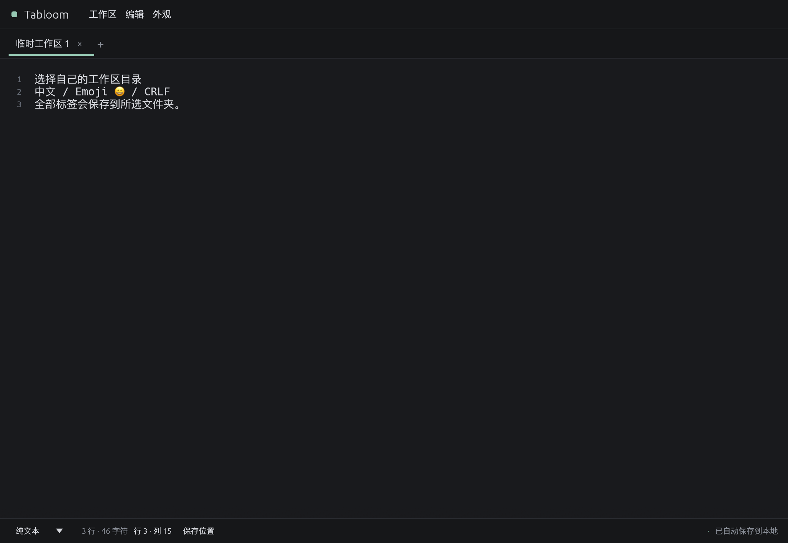

# 工作区目录选择

日期：2026-10-23。用户反馈恢复目录位置不直观、实例锁冲突时不知如何处理，要求可以选择工作区目录。

## 使用

工作区菜单新增“选择工作区目录…”和“打开保存目录”。状态栏常驻“保存位置”入口，可显示完整路径并打开系统文件管理器。恢复提示不再把路径只藏在详情中，并提供选择目录、打开目录及“以后使用当前恢复目录”。

选择专用空目录时，当前完整 Snapshot 写入目标后才切换，包含全部标签、文本、语法范围和外观；原目录文件保留。选择已存在的工作区时先保存原工作区，再载入目标，不覆盖目标已有内容。原保存失败时会保留编辑状态，提示先选空目录保存应急副本。空目录保存也可用于当前仅在内存的内容。

选择当前正在使用的恢复目录不会重复申请同一把锁，会先保存，再清除恢复警告并记为常规默认目录。锁定或无效的目标保持原文档与原保存路径；取消系统对话框没有副作用。

选择记录通过临时文件、文件同步及原子替换写入应用配置目录的 `workspace-location.json`；启动读取绝对路径。记住位置失败时明确提示，本次已切换目录仍可继续编辑，不伪报下次启动位置已记住。没有配置时沿用标准数据目录，配置不可读取时沿用非阻塞恢复策略。

打开已有工作区会清理旧文档的 UI 缓存/搜索与撤销状态，避免拷贝出的相同 UUID 互相串入撤销；保存到空目录保留当前编辑状态。恢复目录与主目录不自动合并。

## 实现

- `src/settings/mod.rs`：选择记录、原子写入与启动路径解析。
- `src/main.rs`：从记住的目录启动。
- `src/app.rs`：保存/打开所选目录、恢复目录转常规工作区、目录选择器、目录打开器、可见位置及通知。
- `src/ui/text.rs`：集中提示文案。
- `tests/workspace_directory.rs`：目录切换与配置隔离测试。
- `examples/directory_smoke.rs`：临时目录下的原生窗口保存、记住 Unicode 路径、重启校验。
- Linux 主程序探针同时验证默认目录和已配置的自选目录启动。

## 验证与边界

macOS ARM64：101 项 Rust 测试、fmt、all-targets check、严格 clippy、release 与 `.app` 打包通过。目录原生探针通过，含中文/空格路径、保存当前内容、配置重读和重新打开。7 项新增测试覆盖空目录全标签保存、已有目录切换保留两边内容、锁定/无效路径保持原状态、恢复目录转正常使用、选择配置原子性/Unicode/非法相对路径、纯内存内容落盘，以及源保存失败时拒绝切换到已有数据但仍可保存到空目录。

Linux ARM64/X11：101 项 Rust 测试及严格 clippy 通过；完整 Xvfb/Mesa 流程已验证默认目录和自选目录的真实主程序启动、原生目录切换、四主题、持久化恢复、文件互操作、真实 xclip 剪贴板与约 1MiB 编辑。Windows、Linux x86_64、Wayland 尚未实测；CI 配置未远程运行。系统目录选择器使用现有 rfd，不新增依赖；原生探针由代码指定临时路径，不模拟用户在系统选择器里选目录。

本次没有强制退出用户正在编辑的实例，没有自动覆盖原目录或恢复目录。锁文件不能通过删除来解除：正常退出持有锁的实例，或选择其他专用目录。选择恢复目录即可继续其中内容，选择空目录则可带走当前全部标签。应用内部 JSON 不作为普通文本文件直接修改。
